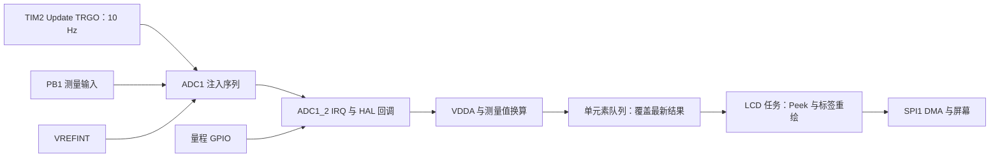

# Scope · STM32F103 FreeRTOS 数字万用表

基于 **STM32F103RCT6、STM32 HAL 与原生 FreeRTOS** 的测量显示固件。当前应用通过 ADC 注入序列获取测量输入与内部参考电压，识别物理量程开关，换算电压或电阻，经单元素队列交给 LCD 任务显示；六路按键触发蜂鸣反馈，LED 任务提供运行指示。

项目保留 `Scope` 名称，**当前主程序实现的是数字万用表数据展示，没有接入示波器波形显示**。本文以仓库源码和现有 EIDE 配置为依据；标称量程、采样频率和时间间隔是配置值，测量精度和板级表现需实测确认。

## 目录

- [功能与实现范围](#功能与实现范围)
- [仓库结构与阅读路线](#仓库结构与阅读路线)
- [硬件接口与时钟](#硬件接口与时钟)
- [启动流程与任务划分](#启动流程与任务划分)
- [测量链路与换算公式](#测量链路与换算公式)
- [LCD 与 SPI DMA](#lcd-与-spi-dma)
- [按键、蜂鸣器与 LED](#按键蜂鸣器与-led)
- [FreeRTOS 配置与同步](#freertos-配置与同步)
- [构建、下载与调试](#构建下载与调试)
- [已知边界与改进方向](#已知边界与改进方向)
- [验证方法与资料](#验证方法与资料)

## 功能与实现范围

| 功能 | 当前实现 | 源码 |
| --- | --- | --- |
| 电压测量 | 50 V / 10 V / 2 V 三档，识别开关后按前端参数换算 | [dmm.c](User/dmm.c) |
| 电阻测量 | 1 kΩ / 10 kΩ / 100 kΩ / 1 MΩ 四档 | [dmm.c](User/dmm.c) |
| 参考电压补偿 | 用内部 VREFINT 和名义 1.20 V 反算 VDDA | [dmm.c](User/dmm.c) |
| 测量数据交接 | 长度 1 的 FreeRTOS 队列，中断覆盖，任务窥读 | [dmm.h](User/dmm.h) |
| LCD 显示 | 启动清屏，约每 2 s 重绘 DMM 标签；数据使用 SPI1 TX DMA | [lcd_task.c](User/Task/lcd_task.c) |
| 按键交互 | 六路按键扫描，释放边沿触发蜂鸣 | [key_task.c](User/Task/key_task.c)、[key.c](Drivers/key.c) |
| 蜂鸣反馈 | 上限 10 的计数信号量，每次事件鸣叫约 100 ms | [buzzer_task.c](User/Task/buzzer_task.c) |
| LED 指示 | LED1 高低电平各约 100 ms | [main.c](Core/Src/main.c) |

当前未实现电流/频率测量、自动量程、HOLD、相对测量、测量值滤波和完整波形采集显示。`lcd.h` 包含波形绘制接口，图像头文件也存在，但当前 LCD 任务没有调用它们。DMA 用于 **SPI 显示发送**，ADC 使用 **定时器触发＋转换中断**。

## 仓库结构与阅读路线

```text
Scope/
├── Core/
│   ├── Src/main.c                    时钟、外设初始化、任务创建
│   ├── Src/stm32f1xx_it.c             ADC/DMA/TIM6 中断入口
│   ├── Src/stm32f1xx_hal_msp.c        外设引脚、DMA 和 NVIC
│   ├── Src/stm32f1xx_hal_timebase_tim.c  HAL 的 TIM6 时间基准
│   ├── Inc/FreeRTOSConfig.h           内核配置
│   └── Startup/startup_stm32f103rctx.s 启动与向量表
├── User/
│   ├── dmm.c / dmm.h                 测量、量程、邮箱
│   ├── GUI/dmm_label.c               标签与数值重绘
│   ├── Task/                         按键、蜂鸣器、LCD 任务
│   └── Keys/                         六个按键的句柄和回调
├── Drivers/
│   ├── STM32F1xx_HAL_Driver/          HAL
│   ├── CMSIS/                        内核和设备头文件
│   ├── key.c / key.h                 通用按键驱动
│   ├── lcd.h / lcd.a                 LCD 接口和预编译库
│   └── fp.h                          LCD 初始化参数依赖
├── FreeRTOS/Inc/ 与 Src/              内核、Cortex-M3 port、heap_4
├── .eide/eide.yml                     当前构建配置
├── Scope.ioc                         CubeMX 外设配置
├── STM32F103RCTX_FLASH.ld             链接脚本
└── README.md
```

建议从 `main.c` 看初始化和任务，再读 `dmm.c → dmm_label.c → lcd_task.c`，最后检查按键、时间基准和 FreeRTOS port。LCD 库的内部绘图实现没有提供对应 C 源码，不能将整个 LCD 库描述为本仓库自行实现的驱动。

## 硬件接口与时钟

### 引脚与外设

| 模块 | 引脚/资源 | 配置 |
| --- | --- | --- |
| MCU | STM32F103RCT6 / Cortex-M3 | 链接区域为 256 KiB Flash、48 KiB RAM |
| 测量输入 | PB1 / ADC1_IN9 | 模拟输入，注入 Rank 1 |
| 内部参考 | ADC_CHANNEL_VREFINT | 注入 Rank 2，无外部引脚 |
| 电压档识别 | PB12 / PB13 / PB14 | 下拉输入，高电平分别选 50 V / 10 V / 2 V |
| 电阻档识别 | PB15 / PC6 / PC7 | 下拉输入，高电平分别选 10 kΩ / 100 kΩ / 1 MΩ |
| LCD SCK / MOSI | PB3 / PB5 | SPI1 重映射，DMA1 Channel 3 发送 |
| LCD RS / NSS | PC12 / PD2 | 命令/数据切换与软件片选 |
| LCD RST / BL | PB4 / PB6 | 复位与背光 |
| KEY1 / KEY2 | PC9 / PA8 | 上拉输入，低电平按下 |
| KEY3 / KEY4 | PC15 / PC0 | 上拉输入 |
| KEY_UP / KEY_DOWN | PC13 / PC14 | 上拉输入 |
| 蜂鸣器 | PC8 | GPIO，高电平鸣叫的应用约定 |
| LED1 / LED3 | PC3 / PC1 | GPIO，主程序仅为 LED1 创建任务 |
| USART1 TX / RX | PA9 / PA10 | 115200 bps、8N1；当前任务未实现串口协议 |
| 调试 | SWD | 禁用 JTAG 释放 PB3/PB4，保留 SWD |

标称测量档位来自软件换算，不等于经过标定的精度或输入耐压等级。接入实际信号前，应核对测量前端和保护电路；仓库尚未包含完整原理图。

### 时钟与速率

[SystemClock_Config()](Core/Src/main.c) 使用 HSE、PLL ×9，正常配置为 SYSCLK/HCLK 72 MHz、PCLK1 36 MHz、PCLK2 72 MHz，ADC 时钟 PCLK2/6=12 MHz。

| 资源 | 当前配置 | 正常时钟条件下推算 |
| --- | --- | --- |
| TIM2 | PSC=7199，ARR=999，Update TRGO | `72 MHz / 7200 / 1000 = 10 Hz`，每 100 ms 触发注入序列 |
| SPI1 | 8 bit、模式 0、MSB first、分频 4 | SCK 约 18 MHz，需结合实际波形验证 |
| FreeRTOS SysTick | `configTICK_RATE_HZ=100` | 一个 tick 为 10 ms |
| HAL TIM6 | 1 MHz 计数、ARR=999 | HAL tick 为 1 ms |

APB1 分频为 2 时，对应定时器时钟倍频，因此 TIM2/TIM6 计算基准为 72 MHz。采样 10 Hz 与显示约 0.5 Hz 是不同速率，显示任务只读取最近的数据，不逐条展示全部样本。

## 启动流程与任务划分

### 从复位到调度

```text
Reset_Handler
  → 设置栈、SystemInit
  → 初始化 .data / .bss、C 运行库
  → main
  → HAL_Init、SystemClock_Config
  → GPIO / DMA / USART1 / SPI1 / ADC1 / TIM2 初始化
  → Buzzer_Init / LCDTask_Init / DMM_Init
  → 创建四个应用任务
  → vTaskStartScheduler
```

向量表直接连接 `vPortSVCHandler`、`xPortPendSVHandler` 和 `xPortSysTickHandler`。`stm32f1xx_it.c` 中同名 Cortex 异常模板函数不是当前向量表实际使用的 RTOS入口。

### 任务表

| 任务 | 优先级 | 栈深度：word / 字节 | 工作方式 |
| --- | ---: | --- | --- |
| `keyTask` | 3 | 128 / 512 | 扫描六键，`vTaskDelay(10 ms)` |
| `vLCDTask` | 2 | 256 / 1024 | 启动清屏，重绘标签后延时 2000 ms；DMA 期间阻塞等待 |
| `vBuzzerTask` | 1 | 32 / 128 | 等待计数信号量，GPIO 高电平 100 ms |
| `vLED1Task` | 1 | 32 / 128 | 高、低电平各 100 ms |

这里的栈单位是 `StackType_t`，Cortex-M3 上为 4 字节。四个是应用任务数量，调度器还会创建 Idle；软件定时器启用后也会创建 Timer Service 任务。优先级数字越大，任务优先级越高，不能与 NVIC 数值方向混淆。

`vTaskDelay()` 是相对延时，实际循环间隔包含处理耗时和调度影响；需要稳定周期时可采用 `vTaskDelayUntil()` 并测量执行时间。蜂鸣器和 LED 栈较小，当前没有栈溢出检查或栈水位统计，不能仅凭可编译就判断运行栈安全。

## 测量链路与换算公式



### 注入序列和启动

`DMM_Init()` 创建队列，调用 `HAL_ADCEx_Calibration_Start()`，启动注入转换中断，再启动 TIM2。实际测量使用两个注入 Rank：

| Rank | 通道 | 采样时间配置 |
| --- | --- | --- |
| 1 | ADC_CHANNEL_9 / PB1 | 1.5 ADC 周期 |
| 2 | ADC_CHANNEL_VREFINT | 239.5 ADC 周期 |

规则组虽然也配置了通道 9 和 TIM8 TRGO，DMM 模块没有启动规则组转换，不能将其写成实际测量链路。当前 ADC 没有 DMA 配置。

### VDDA 补偿

令测量输入原始值为 `Ndmm`，内部基准原始值为 `Nref`：

```text
VDDA = 4095 / Nref × 1.20 V
Vadc = Ndmm / 4095 × VDDA
```

这是基于内部参考名义值的供电补偿，和 `HAL_ADCEx_Calibration_Start()` 的 ADC 校准不是同一件事。它可以减轻 VDDA 波动影响，但不会消除内部基准误差、电阻误差、前端偏置和温漂；代码没有 `Nref=0` 或异常样本检查。

### 量程识别

按 `DMM_GetRange()` 的判断顺序：

| Range | 标称档位 | 识别条件 |
| ---: | --- | --- |
| 0 | 50 V | PB12 高 |
| 1 | 10 V | PB13 高 |
| 2 | 2 V | PB14 高 |
| 6 | 1 MΩ | PC7 高 |
| 5 | 100 kΩ | PC6 高 |
| 4 | 10 kΩ | PB15 高 |
| 3 | 1 kΩ | 以上均不满足，默认档 |

多个引脚同时为高时，返回第一个匹配项。没有开关消抖、无效组合识别或自动继电器量程切换。

### 电压换算

```text
Vin = (2 × Vadc - 2) × (R1 + R2) / R2
```

| Range | R1 | R2 | 分压补偿倍数 |
| ---: | --- | --- | ---: |
| 0 | 960 kΩ | 40 kΩ | 25 |
| 1 | 800 kΩ | 200 kΩ | 5 |
| 2 | 0 Ω | 1 kΩ | 1 |

`2×Vadc-2` 体现软件采用的前端增益/偏置关系，不能只用纯电阻分压解释完整公式。具体模拟电路需要原理图确认。

### 电阻换算

```text
R4  = (2 × Vadc - 2) / (4.5 - 2 × Vadc) × R3
Rin = R4 × 1 MΩ / (1 MΩ - R4)
```

四个电阻档使用 `R3={200 Ω, 2 kΩ, 20 kΩ, 200 kΩ}`，由 `range-3` 索引。第二步按代码模型消去 1 MΩ 并联支路影响。当分母接近 0 或 `R4` 接近 1 MΩ 时，结果敏感；当前没有开路、超量程、负值或非有限值状态处理。

### 单元素邮箱

```c
typedef struct {
    uint8_t Range;  // 0–2：电压；3–6：电阻
    float Value;    // V 或 Ω
    float Vdda;    // 本次换算使用的参考电压
} DMMData_t;
```

ADC ISR 用 `xQueueOverwriteFromISR()` 按值复制结构体，显示任务用 `xQueuePeek(..., 0)` 非阻塞读取且不移除。这适合只关心最新值的仪表显示，不保留完整采样历史，也不能用来传递波形序列。

当前 `DMM_GetData()` 未初始化局部结构体，也没检查 Peek 返回值。第一条数据到达前读取可能得到无效 Range/Value，需要补充有效标志或失败返回接口。

## LCD 与 SPI DMA

### 库与硬件适配层

`Drivers/lcd.h`、`lcd.a` 和 `fp.h` 提供外部 LCD 组件。应用通过四个回调适配背光、复位、命令发送和数据发送；头文件给出的坐标范围为 320×240。具体控制器型号和库内部实现需由硬件及组件资料确认。

命令使用 `HAL_SPI_Transmit()` 轮询；数据使用 `HAL_SPI_Transmit_DMA()`，发送函数随后阻塞等待二值信号量。DMA 搬运期间 CPU 可以运行其它就绪任务，但当前 API 对调用者仍是同步完成语义。

```text
LCD task → RS/NSS 设置 → HAL_SPI_Transmit_DMA
         → xSemaphoreTake：阻塞
DMA1 Channel3 IRQ → HAL_DMA_IRQHandler
         → HAL_SPI_TxCpltCallback
         → xSemaphoreGiveFromISR + portYIELD_FROM_ISR
LCD task 继续 → 释放 NSS
```

缓冲区必须在 DMA 完成前保持有效且不能被覆盖。当前没有检查 DMA 启动返回值，也没有等待超时和错误回调恢复；启动失败或丢完成事件可能永久等待。

`LCDTask_Init()` 在调度器启动前调用 `lcd_init()`。若外部库初始化调用数据回调，而 DMA 尚未完成就进入不可满足的阻塞等待，需要检查启动顺序及 FreeRTOS API 使用阶段；仅从库头文件无法断言该路径是否发生。

### 标签重绘

`DMMLable1_Repaint()` 清除数值区域，打印量程名和带 SI 前缀的测量值。量程名称数组有 7 项，但单位数组 `uintNames` 只有 6 项；`Range=6` 的 1 MΩ 档会越界访问。其他异常 Range 也没有保护，这是当前静态可见的缺陷，本文仅记录，未修改固件。

当前只有一个应用任务主动绘图，没有多任务 LCD 互斥控制；后续增加其他显示调用者时，需要明确统一显示任务或互斥访问策略。

## 按键、蜂鸣器与 LED

按键层分为 `Drivers/key.c` 通用状态处理、`User/Keys/` 独立句柄与回调、`keyTask` 统一扫描。当前识别“上一次低电平、这一次高电平”的释放边沿，六个回调均只调用 `Buzzer_Beep()`，没有改变界面、量程或上下移动逻辑。

10 ms 扫描间隔不等于完整消抖算法。代码没有连续稳定样本计数、消抖状态机或长按/多击检测，机械抖动仍可能造成重复事件。

蜂鸣器计数信号量为 `xSemaphoreCreateCounting(10, 0)`。每取出一个事件鸣叫约 100 ms，积压可逐个处理；超过计数上限时 Give 会失败，而调用者未检查结果，因此不能保证任意连续输入都不丢事件。相邻事件之间没有专门的静音间隔，持续积压时声音可能连在一起。

LED1 任务高低电平各延时 100 ms，名义完整周期 200 ms。LED 闪烁仅说明该任务得到运行机会，不证明测量精度或全部任务正常。

## FreeRTOS 配置与同步

| 项目 | 当前配置 |
| --- | --- |
| 内核版本 | 仓库 `task.h` 标识 V11.1.0 |
| 调度 | 抢占开启，同优先级时间片开启 |
| 最大优先级数 | 5，即 0–4 |
| Tick | 100 Hz，32 位 TickType |
| 分配方式 | 动态分配，`heap_4.c`，内核堆 8192 B |
| 软件定时器 | 开启，服务任务优先级 4，队列长度 10；应用未建立软件定时器 |
| newlib 支持 | `configUSE_NEWLIB_REENTRANT=1` |
| 中断门限 | `configMAX_SYSCALL_INTERRUPT_PRIORITY=5<<4` |
| 栈溢出/分配失败 Hook | 当前关闭；栈水位 API 也未启用 |

ADC1_2 和 DMA1_Channel3 的 NVIC 优先级配置为 5，配合当前 Cortex-M3 port 的系统调用门限使用 FromISR API。NVIC 数字越小优先级越高；不能任意将调用内核 API 的 ISR 提升到门限以上。

ISR 中初始化 `xHigherPriorityTaskWoken=pdFALSE`，用 FromISR 接口投递，再交给 `portYIELD_FROM_ISR()` 请求必要的调度。任务使用普通 API；阻塞等待信号量不会像忙轮询一样占着 CPU。

HAL tick 使用 TIM6 的 1 ms 中断，RTOS tick 使用 SysTick 的 10 ms 时间基准。`HAL_Delay()` 为忙等待，不等同 `vTaskDelay()`；LCD 初始化中的 HAL 延时发生在启动阶段。应用数据队列、信号量和任务创建返回值目前均没有完整的失败检查。

## 构建、下载与调试

### 首选 EIDE 工作流

当前构建配置为 [.eide/eide.yml](.eide/eide.yml)，使用 ARM GCC、Cortex-M3、HAL 和原生 FreeRTOS，链接 [STM32F103RCTX_FLASH.ld](STM32F103RCTX_FLASH.ld) 及 `Drivers/lcd.a`。

1. 用 VS Code 打开工程并启用 EIDE，选 `Debug` 目标。
2. 配置本机 ARM GCC 路径，检查 LCD 静态库和链接脚本存在。
3. 执行 EIDE Rebuild，检查编译/链接错误、警告与 RAM/Flash 占用。
4. 输出位于 `build/Debug/`，主要为 `Scope.elf`、`Scope.hex`、`Scope.map` 和编译数据库。
5. 下载使用 EIDE 的 ST-Link/SWD 配置，起始地址 `0x08000000`，速率配置为 4000 kHz；按实际接线和目标供电验证。

工程配置含 `E:/FreeRTOS Worksapce/Scope/Drivers` 的绝对链接路径，换机器或目录需复核。`Release` 目标的包含路径缺少 `User/GUI`，本文未验证其构建。顶层没有通用 Makefile/CMake，内核目录下的 CMake 文件不是本项目构建入口。仓库已含 HAL/CMSIS 源码，LCD 库及其初始化参数仍是必要依赖。

命令行复现可使用 EIDE 已生成的 `build/Debug/builder.params`，例如当前安装环境：

```powershell
$env:DOTNET_ROLL_FORWARD = 'Major'
& "$env:USERPROFILE/.vscode/extensions/cl.eide-3.27.2/res/tools/win32/unify_builder/unify_builder.exe" `
  -p 'build/Debug/builder.params' --rebuild --no-color
```

版本和路径应以本机安装为准。`DOTNET_ROLL_FORWARD` 是对旧构建器运行时兼容的进程环境设置，不修改工程架构。

### 本次构建验证（2026-10-15）

使用现有 EIDE `Debug` 配置和上面的构建器命令执行完整重编译，工具链为 Arm GNU Toolchain 15.2.Rel1、GCC 15.2.1（20251203）。45 个 C 文件及 1 个汇编文件编译、链接通过，退出码 0，0 warning、0 error；RAM 占用 17864 B / 48 KiB，Flash 占用 56168 B / 256 KiB，输出 `Scope.elf` 和 `Scope.hex`。仅调整文档，没有修改源码或工程配置；未进行本次 ST-Link 连接、烧录或板级验证。

### CubeMX 与调试入口

`Scope.ioc` 可查看外设配置。重新生成前应先提交或备份，并检查 USER CODE 区、RTOS 向量表、TIM6 HAL tick 和自定义任务接入，不能直接认为重新生成无影响。

EIDE 项目栏 Debug 与 VS Code F5 是两个配置入口：前者依据 EIDE debugger 设置动态生成，后者使用本地 `.vscode/launch.json`。连接检查应以实际入口和 Debug Console 为依据。成功构建只说明编译和链接通过；ST-Link 下载校验、断点命中及功能测试应分别验证。

## 已知边界与改进方向

下表记录源码行为，改进项尚未在本文中实施。

| 位置 | 边界/问题 | 改进方向 |
| --- | --- | --- |
| `DMM_GetData()` | 空队列时返回未初始化数据 | 初始化、有效标志、检查 Peek 返回值 |
| `dmm_label.c` | 单位数组缺第 7 项，Range 缺保护 | 完整映射和边界检查 |
| 测量换算 | 参考值为 0、分母近 0、开路/超量程未处理 | 样本检查与明确状态码 |
| 量程输入 | 多个高电平取首项，无消抖/无效档 | 稳定确认、非法组合检测、切档过渡 |
| ADC 前端 | PB1 采样时间较短，模拟参数未标定 | 按源阻抗检查采样时间，做多点标定 |
| ADC ISR | 中断内浮点换算和 GPIO 查询 | 测耗时；必要时中断仅投递原始样本，任务换算 |
| SPI DMA | 忽略启动返回值，无超时/错误恢复 | 状态检查、有限等待、取消与重试策略 |
| LCD 启动 | 调度器前的库初始化回调行为未确认 | 验证初始化时序与等待路径 |
| 按键/蜂鸣器 | 边沿检测缺完整消抖，计数队列可满 | 消抖状态机、Give 失败处理与事件策略 |
| 内存 | 32 word 小栈、对象创建无失败检查 | 栈水位、溢出 Hook、堆余量和分配失败处理 |
| 显示 | 约 2 s 更新，不做样本历史或波形 | 按需求调整刷新；波形需单独缓存与触发设计 |
| 构建 | 绝对路径、外部静态库和 Release 包含目录 | 明确依赖，独立目录复现与 Release 检查 |

## 验证方法与资料

- **测量：** 用已知电压和标准电阻逐档对比，记录误差、VDDA、电压/温度条件，验证开路及量程边界。
- **时序：** 测 TIM2 触发间隔、ADC ISR 耗时、SPI 频率、DMA 完成及显示刷新间隔。
- **同步：** 检查无样本启动、DMA 启动失败、超时、蜂鸣事件突发与堆分配失败。
- **资源：** 查看 map、任务栈水位、剩余堆，关注 LCD 库调用和格式化路径。
- **硬件：** 单独核验 ST-Link 下载校验、断点、引脚波形和整机功能，保存对应固件版本。

仓库尚未提供完整原理图、BOM、整机照片或统一测量报告，也未指定统一项目许可证。HAL、FreeRTOS、LCD 静态库和图像资源应分别保留并核对来源与使用条件。
